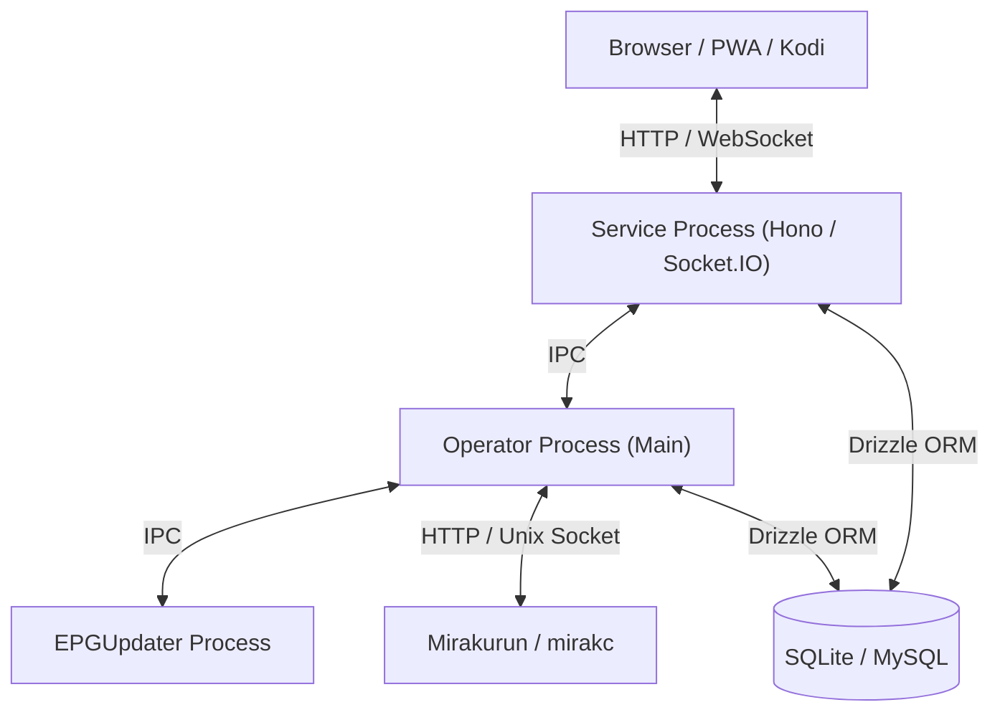

# システムアーキテクチャ解説

本ドキュメントでは、EPGDeck の全体構成、プロセス分離モデル、バックエンド設計パターン、およびフロントエンド構造について解説します。

---

## 1. 全体概要

EPGDeck は、**Node.js / Hono** ベースのバックエンドと、**Svelte 5** ベースの SPA フロントエンドで構成されています。

---

## 2. プロセス分離モデル

安定性と負荷分散のため、EPGDeck は役割ごとに独立した Node.js プロセスに分離して動作します（`src/index.ts`
で起動・管理）。

| プロセス                         | 役割                 | 主な責務                                                                                                                                                                         |
| -------------------------------- | -------------------- | -------------------------------------------------------------------------------------------------------------------------------------------------------------------------------- |
| **Operator** (メインプロセス)    | 録画・チューナー管理 | 録画予約の競合解決・重複排除（詳細は [録画予約アルゴリズム仕様書](reservation-algorithm.md) 参照）、Mirakurun からのストリーム受信・録画ファイル書き込み、エンコードキューの管理 |
| **EPGUpdater** (子プロセス)      | 番組表更新           | Mirakurun から定期的に EPG データを取得し、DB（Programs / Services テーブル）を更新                                                                                              |
| **ServiceExecutor** (子プロセス) | Web サーバー         | Hono による REST API、Swagger UI、Socket.IO によるリアルタイム通知、静的ファイル配信                                                                                             |

---

## 3. バックエンド設計パターン

### DI (依存性注入): TypeScript ネイティブ Pure DI

バックエンドの各モジュール（Model, Service, DB Operator 等）は、外部 DI コンテナライブラリ（InversifyJS 等）やレガシーデコレータに依存せず、**Pure DI（TypeScript-native 純粋依存性注入）** により明示的・型安全に管理されています。

- コンテナ定義: `src/model/ModelContainer.ts`
- ファクトリ登録（Composition Root）: `src/model/ModelContainerSetter.ts`
- 各クラスはデコレータ（`@injectable` / `@inject`）を持たないプレーンな TypeScript クラスとして実装され、コンストラクタ経由で依存性を受け取ります。
- コンテナは型安全なアクセサー（`container.loggerModel`, `container.recordedDB` 等）を提供し、テスト用モック差し替え（`rebind().toConstantValue()`）との互換性も維持しています。

### REST API: Hono

API のルーティングは、高速・軽量な Web 標準準拠フレームワーク **Hono** を採用しています。

- ルートハンドラー: `src/model/service/hono/routes/**/*.ts`
- アプリケーション定義: `src/model/service/hono/createHonoApp.ts`
- Swagger UI / OpenAPI ドキュメント: `@hono/swagger-ui` により `/api-docs` および `/api/docs` で提供
- 各エンドポイントは DI コンテナから各種 `*ApiModel` を呼び出し、型安全かつ低レイテンシでレスポンスを返却します。
- **予約・競合エラーハンドリング**: `POST /api/reserves` での重複予約やチューナー競合時に適切な HTTP ステータス（`409 Conflict`, `404 Not Found`, `400 Bad Request`）を返却し、UI（Snackbar）で理由を明示。
- **録画中番組のライフサイクル制御 (途中完了 / 中断 / 取り消し)**:
  - `POST /api/recording/:reserveId/finish`: 録画ストリームを EOF 切断し、実時間確定・サムネイル・エンコード・録画履歴（`RecordedHistory`）登録・予約消化を実行。
  - `POST /api/recording/:reserveId/stop`: ファイル保存・エンコードを行うが未完了扱い（履歴未登録）とし、再放送時に重複除外されないよう維持。
  - `POST /api/recording/:reserveId/discard` (または `DELETE /api/recording/:reserveId`): 録画停止後に書きかけ TS や DB レコードを物理削除。
- **大容量アップロードのストリーム処理**: `POST /api/videos/upload` はメモリ展開せず `file.stream()` から直接ディスクへパイプ書き込みし OOM を防止。
- **実録画時間（duration）の保存原則**: `recorded.duration` は予定枠時間ではなくチューナー受信開始〜終了の実測ミリ秒を保存。
- **データライフサイクルとキャッシュ戦略**:
  - **字幕 (WebVTT)**: ディスク永続化せず、FFmpeg pipe ＋ インメモリキャッシュ（最大 100 件、`mtimeMs` 検証付き）でオンデマンド配信。
  - **サムネイル (シャーディング & 永続化)**: ディスク永続化し、大規模アーカイブ対応として `recordedId % 100` の 2 桁サブディレクトリ（`00/`〜`99/`）へ分散配置。
  - **ドロップログ**: 0 件時は実ファイルを自動削除（`deleteOnNoDrop: true`）し、DB 履歴のみ永続保持。

### ORM: Drizzle ORM & DrizzleHelper

データベースアクセスには **Drizzle ORM**（`@libsql/client` / `mysql2`）を採用しています。

- **Schema / DTO**: `src/db/schema/**/*.ts`, `src/db/entities/**/*.ts`
- **EPGStation 互換性**: テーブル・カラム構造は EPGStation v2.10.0 を踏襲。EPGDeck 独自の優先度カラム `priority`（デフォルト: 5）は起動時に非破壊で自動追加。
- **方言別クエリの集約 (`DrizzleHelper`)**: SQLite / MySQL の構文差異（UPSERT 等）を `DrizzleHelper.ts` に集約。
- **マルチプロセス接続最適化 (SQLite)**: Operator / Service / EPGUpdater の 3 プロセス並行読み書きに対し、WAL モード・NORMAL 同期・`timeout: 10000`（`busy_timeout`）を適用し、ロック競合を自動待機リトライ。

### Node.js 標準組み込み API とゼロ依存アーキテクチャ

Node.js 22+ のモダンな組み込み API を活用し、外部依存や C++ ネイティブアドオンを排除しています。

- **ファイルシステム・容量**: `node:fs/promises` (`statfs`, `mkdir({ recursive: true })`)
- **オブジェクト複製**: `structuredClone`
- **HTTP 通信・ストリーム**: `fetch`, `EventSource`, Web Streams API
- **CLI 引数パース**: `node:util.parseArgs`
- **放送波解析**: ゼロ依存・Pure TypeScript の自製パッケージ `packages/arib-probe`

### 非同期排他制御と直列化キュー (`PromiseQueue`)

同時 API 呼び出しやバックグラウンドタスクの競合を防ぐため、**`PromiseQueue`（FIFO 直列化キュー）** を標準採用しています。

- **ルール排他制御 (`RuleManageModel`)**: 追加・更新・削除・有効化/無効化を `queue.add()` で直列化し、競合エラーによるリクエスト失敗を排除。
- **重処理の平準化**: サムネイル生成や外部コマンド呼び出しの多重起動を抑止。
- **定期ジョブのガード (`StorageManageModel`)**: `isRunning` ガードと `try...finally` により二重実行を抑止しつつロック解除を保証。

### プロセス停止と Graceful Shutdown 設計 (録画中ストリーム・ファイル保護)

OS のシャットダウンやサービス再起動（`systemctl stop` / `docker stop` / SIGINT / SIGTERM）時に、進行中の録画ファイルやデータベースの整合性を確実に保護するための多層防御シーケンスを実装しています（※設計背景および技術検証の詳細は [近代化ロードマップ 兼 ADR (modernization-roadmap.md#11-operator-プロセスの-graceful-shutdown-実装)](modernization-roadmap.md#11-operator-プロセスの-graceful-shutdown-実装) を参照）。

1. **二重シグナル即時保護**:
   - 初回の `SIGINT` / `SIGTERM` で Graceful Shutdown シーケンスを開始。
   - シャットダウン処理中に 2 回目のシグナルを受信した場合は即時強制終了（`process.exit(1)`）し、運用時のハングを防止。
2. **バックグラウンド定期処理の停止**:
   - `StorageManageModel.stop()` により、録画削除を伴う空き容量チェックインターバルを即時停止。
3. **Web API 受信の遮断と Service プロセス停止**:
   - `serviceChild`（ServiceExecutor）へ `SIGTERM` を送信し、Web API / WebSocket の受付を停止。
   - 子プロセスの終了を最大 5 秒間非同期待機（タイムアウト時は `SIGKILL`）。
4. **録画中ストリームのフラッシュと DB 実尺確定 (`RecordingManageModel.stopAll`)**:
   - 全てのアクティブなレコーダーを並列（`Promise.allSettled`）かつ安全に停止。
   - **ストリーム切断**: Mirakurun との接続を安全に解除しチューナーを解放。
   - **TS 書き込み完了待機**: `recFile`（`fs.WriteStream`）の `finish` / `close` イベントを安全に待機し、OS バッファへのフラッシュを完了。
   - **DB 実録画時間（duration）確定**: 実測経過ミリ秒と終了時刻（`endAt`）を `recordedDB.removeRecording` で確定し、`isRecording: false` を反映。
   - **ファイル移動 & サイズ同期**: 一時ディレクトリ（`tempDir`）使用時は本保存先へ移動し、実ファイルサイズを DB へ書き込み。
   - **ドロップログ集計**: `DropChecker` を停止し、ドロップ数集計と 0 件時ログ実ファイル削除を完了。
   - **二重終了防止**: `recEndPromise` により、API からの手動停止や Mirakurun 切断とシャットダウンが重複しても 1 度だけ安全に実行。
   - **不要な後続ジョブ・通知の抑止**: シャットダウン時は番組録画が途中中断された状態となるため、エンコードキュー登録（`pushEncode`）、サムネイル生成、`RecordedHistory`（二重録画防止履歴）登録、予約削除、および通常完了フック（`recordingFinish`）の通知を意図して抑止し、終了間際の不要なプロセス起動や将来の再放送録画スキップ事故を防止。
5. **DB コネクション安全クローズ**:
   - `IDrizzleOperator.closeConnection()` により、SQLite ファイルロック解除または MySQL コネクションプールを安全に終了。

### 内部共有パッケージ (npm workspaces) と Docker ビルド連携

EPGDeck では、外部依存のないドメインロジックや共通パイプライン（ARIB TS ストリーム解析器 `packages/arib-probe`、FFmpeg トランスコードエンジン `packages/enc-helper`）をルート `package.json` の `workspaces: ["packages/*"]` で管理しています。

コンテナビルド（`Dockerfile`）におけるレイヤーキャッシュ効率化およびシンボリックリンク破損防止のため、以下の設計原則を遵守します：

1. **`package.json` の独立性 (`private: true`)**:
   - 内部専用パッケージには必ず `"private": true` を設定する。
2. **自動ビルドフック（`"prepare"` 等）の排除**:
   - `npm ci` 実行時に自動実行される `"prepare": "npm run build"` 等のスクリプトは**配置してはならない**。
   - 理由: Docker ビルドでは `package.json` のみを先行コピーして `npm ci`（依存関係インストール）を行うため、TypeScript ソースコード（`src/`）がまだ存在しない段階で `tsc` が発火し、Docker ビルドが破損するため。
3. **ビルドの一元化 (`npm run build`)**:
   - パッケージのコンパイルは、ルートの `npm run build`（`tsc -p tsconfig.build.json` および `npm run build --workspaces`）のパイプラインに委譲する。
4. **Dockerfile における 2 ステージ同期**:
   - **builder ステージ**: `COPY packages/*/package.json ./packages/*/` を `npm ci` 前に行う。
   - **runner ステージ**: `npm install --omit=dev` 後、`node_modules/<pkg>` はルート直下の `packages/<pkg>` への相対シンボリックリンクとなるため、`COPY --from=builder /app/packages ./packages` で実体ディレクトリを確実に同期する。

---

## 4. フロントエンド設計

- **ビルドツール**: **Vite 8** (`@sveltejs/vite-plugin-svelte`)
    - Rolldown エンジンによる高速バンドル（ビルド時間約 2.6 秒）および HMR (Hot Module Replacement) に対応。
    - ルートレベルの動的インポート（Lazy Loading）により、初回アクセス時の JS 転送量を最小化。
- **フレームワーク**: **Svelte 5** (Runes `$state`, `$derived`, `$props`, `$effect` 準拠)
    - 仮想 DOM レスによる高速な描画と省メモリ設計、軽量なバンドル構成。
- **スタイル / UI システム**: **Tailwind CSS v4** + `@tailwindcss/vite`
    - デザインシステムを `flex flex-col gap-4 sm:gap-5`（16px / 20px）、`p-4 sm:p-5`、`rounded-2xl` のデザイントークンで全画面統一。
    - ダークモードとライトモードの完全対応（高輝度アクセントジャンルカラー採用）。
- **ルーター**: Svelte 5 ネイティブ Reactive Router (`client/src/lib/router.svelte.ts`)
    - HTML5 History モード完全連動、クエリパラメータ・URL 状態のリアクティブ管理。
- **巨大コンポーネントの関心事分離**:
    - `VideoPlayer.svelte` から再生シークバー・音量・倍速・全画面等を `VideoControls.svelte` に分離。
    - ARIB 字幕・文字スーパーのライフサイクル管理を `SubtitleManager.ts` に独立化。
- **ドメインロジックの純粋関数化と一元化**:
    - 各画面（Dashboard, Guide, Reserves）に分散していた「予約が現在録画中であるか」の判定を
      `client/src/lib/utils/recording.ts`（`isReserveCurrentlyRecording`）に集約。`isConflict`（チューナー競合）除外を含め、完全な単体テストで保証。
- **UI ベースの非同期ダイアログ (`confirmDialog`)**:
    - Svelte 5 `$state` を用いた非同期 Promise ベースの共通モーダル（`ConfirmModal.svelte`）を採用。ダークモードやキーボード操作（ESC/Enter）に対応。
- **非ブロッキング通信と状態整合性**:
    - 画面遷移時やデータ取得時に直列 `await` で待機せず、`Promise.all`
      による並列フェッチや補助データのバックグラウンド非同期取得を徹底し、UI 描画のブロックを排除。
- **型安全な Hono RPC クライアント & キャッシュ一元化**:
    - バックエンドと型同期された Hono RPC クライアント（`hono/client` の `hc`）を採用（`client/src/lib/apiClient.ts`）。
    - 認証トークン管理を `client/src/lib/authStorage.ts` に独立化し、`apiClient`
      のカスタム fetch で Bearer トークンを透過的に自動注入。
    - サーバー設定データのキャッシュと取得を一元化する
      `configStore`（`client/src/lib/stores/config.svelte.ts`）により、画面遷移時の重複 API フェッチを抑止。

---

## 5. テスト・品質保証基盤

テスト戦略、スタンドアロン E2E サーバー、MySQL 実機結合テスト、GitHub Actions
CI パイプラインの詳細については、以下の専門ドキュメントをご参照ください。

👉 **[テスト & CI/CD アーキテクチャ仕様書](testing.md)**

- Vitest による高速単体テスト基盤（SQLite インメモリ）
- MariaDB 10.11 / MySQL 8.0 実機結合テスト（Docker ポート 13306）
- Playwright E2E テスト（スタンドアロンサーバー・先行シードパイプライン）
- GitHub Actions 1 ジョブ統合による 2 分台オールグリーン CI 最適化

---

## 6. 近代化ロードマップ 兼 アーキテクチャ決定記録 (ADR)

長期的な安定稼働、依存ライブラリのアップデート容易性、開発体験（DX）向上のための段階的改善計画、および将来の判断ミス・巻き戻しを防止するための設計決定記録（Why / ADR）については、以下をご参照ください。

👉 **[アーキテクチャ近代化ロードマップ 兼 意思決定記録 (ADR)](modernization-roadmap.md)**

