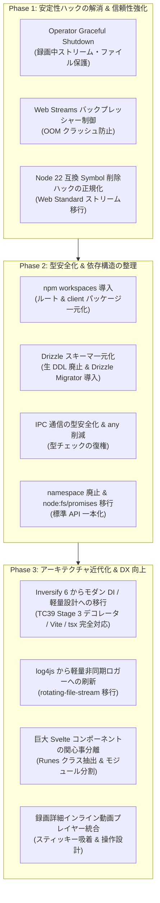

# アーキテクチャ近代化ロードマップ 兼 意思決定記録 (Modernization Roadmap & ADR)

本ドキュメントでは、EPGDeck の長期的な安定稼働、モダン技術スタックへの追従、および依存パッケージのアップデート容易性（保守性）を高めるための改善ロードマップとともに、**将来の判断を誤らないための「意思決定記録（ADR / Why）」** を体系的に記録します。

> [!IMPORTANT]
> **本ドキュメントの役割（将来の巻き戻し・判断ミス防止）**:
> システムの現行仕様（State）は各種専門仕様書（`architecture.md` 等）に記述されていますが、本ドキュメントは**「なぜその設計を採用したのか」「なぜ別の選択肢を捨てたのか」「二度と踏んではいけない地雷・過去の技術検証結果は何か」** を恒久保存するための記録（Single Source of Why）です。
> コードのリファクタリングや仕様変更を検討する際は、必ず本ドキュメントを参照して過去の教訓を損なわない設計を行ってください。

---

## 1. 背景と方針

EPGDeck は、Node.js 22 (ESM)、Hono (RPC)、Svelte 5 (Runes)、Tailwind CSS v4、Drizzle ORM などの最新技術を基盤として採用し、大幅なリファクタリングを遂げてきました。

一方で、EPGStation 時代から引き継がれた設計資産（InversifyJS 6.x による DI、TypeORM 時代のエンティティクラス、手動 Promise ラッパー、`any` の多用等）と、モダンな Web 標準（Web Streams、型推論ドリブンな設計）が混在しており、以下の 3 つの観点から段階的な近代化を推進します。

1. **安定稼働の強化 (Reliability & Robustness)**: プロセス終了時の録画データ保護、ストリーミング時の OOM 防止、脆い内部 Symbol ハックの正規化。
2. **アップデート容易性の向上 (Maintainability & Future-proofing)**: パッケージ管理の一元化、スキーマ二重管理の解消、型安全性の回復。
3. **アーキテクチャの近代化 (Modern Idioms & DX)**: レガシーデコレータ依存からの脱却、モダンロガーへの刷新、フロントエンドの関心事分離。

---

## 2. 改善タスク一覧と詳細設計

---

### Phase 1: 安定性ハックの解消 & 信頼性強化 (最優先)

#### 1.1 Operator プロセスの Graceful Shutdown 実装
> **ステータス**: 実装完了 (`v0.1.0-beta.2`)

- **対象ファイル**: `src/index.ts`, `src/model/operator/recording/RecordingManageModel.ts`, `src/model/operator/recording/RecorderModel.ts`, `src/model/operator/recording/IRecordingManageModel.ts`, `src/model/operator/recording/IRecorderModel.ts`
- **課題**:
  従来、SIGINT / SIGTERM 受信時に `shutdown` 関数は `serviceChild`（ServiceExecutor）の停止のみを待機し、`process.exit(0)` で即座に終了していた。録画中のレコーダー（Mirakurun ストリーム、TS 書き込みパイプ、一時ファイル等）の終了処理が呼ばれず、OS シャットダウンやサービス再起動時に書きかけの TS ファイルが破損するリスクがあった。
- **実装内容**:
  1. `shutdown` シーケンスを刷新:
     - `StorageManageModel.stop()` で定期空き容量チェックを安全に停止。
     - `serviceChild` へ SIGTERM を送信して API 受信を遮断。
     - `RecordingManageModel.stopAll()` により、録画中レコーダー群を並列で安全に停止・フラッシュ。
     - `RecorderModel.stop()` / `recEnd()` において、Mirakurun ストリーム切断、`fs.WriteStream`（`recFile`）の書き込み完了（`finish`/`close`）待機、`recordedDB.removeRecording`（実録画時間 `duration` および `endAt` 確定、`isRecording: false`）、一時ディレクトリ（`tempDir`）からの移動、DB 動画ファイルサイズ更新、ドロップログ集計および 0 件時ログ削除を完遂。
     - `serviceChild` のクリーン終了（最大 5 秒待機）を確認。
     - `IDrizzleOperator.closeConnection()` で DB コネクション（SQLite / MySQL）を安全にクローズ。
  2. 2 回目のシグナル受信時は即時強制終了（`process.exit(1)`）する二重安全機構を配備。
  3. `recEndPromise` による並行終了処理の重複実行防止機構を実装。

#### 1.2 動画・ライブストリーミングにおけるバックプレッシャー制御の導入
> **ステータス**: 実装完了 (`v0.1.0-beta.2`)

- **対象ファイル**: `src/model/service/hono/routes/streams.ts`, `test/unit/stream_routes.test.ts`
- **課題**:
  従来、`src/model/service/hono/routes/streams.ts` において Node.js `Readable` から Web Streams `ReadableStream` への手動変換時に `nodeStream.on('data', chunk => controller.enqueue(chunk))` と無制限にエンキューしていた。クライアント側のネットワーク遅延時や再生一時停止時にメモリが無限肥大化し、ヒープ枯渇（OOM クラッシュ）を引き起こす危険があった。
- **実装内容**:
  1. **Web Standards 準拠の自動バックプレッシャー制御**:
     - Node.js 17+ 標準の `Readable.toWeb(nodeStream)` を導入。
     - `@hono/node-server` のソケット書き込み・クライアント受信バッファの状態（drain）に応じて `nodeStream.pause()` / `resume()` が自動連動し、メモリ消費を一定の上限（数ブロック程度）に抑制。
  2. **堅牢なストリームライフサイクル管理 & リソース即時解放**:
     - `cleanup` 処理において、`keepTimer` の停止、`nodeStream.destroy()` の即時実行、`streamApiModel.stop(streamId, true)` の待機を体系化。
     - クライアント切断イベント（`c.req.raw.signal` の `abort`、`c.env.incoming` / `c.env.outgoing` の `close` / `error`）、ストリーム自然終了（`end` / `close`）、およびストリームエラー（`error`）の全経路で `cleanup` を漏れなく発火。
     - リクエスト開始時点で既に切断されている場合（`signal.aborted` やソケット `destroyed`）は即座に 400 を返し、不要なトランスコードやチューナー占有を防止。
     - ストリーム生成非同期処理（`startFn`）待機中に切断が発生した場合のゾンビストリーム残留競合を解消し、生成直後の即時クリーンアップと 400 早期返却を保証。
     - キープアライブタイマー（10 秒毎）でエラーが発生した際も自動的に `cleanup` を発火し、ゾンビストリームの残留を抑止。
  3. **網羅的単体テスト（27 シナリオ）の配備**:
     - `test/unit/stream_routes.test.ts` を新設し、バックプレッシャーによる読み取り停止、正常 EOF、`AbortSignal` 切断、`reader.cancel()` 切断、ストリームエラー時の安全終了、事前破棄ソケット即時 400 拒絶、生成待機中切断クリーンアップ、`incoming`/`outgoing` ソケットの `close`/`error` イベント連動、キープアライブ失敗時の自動停止、Tuner 503 エラー、各種メディア配信（M2TS, M2TS-LL, MP4, WebM）を検証。

#### 1.3 静的ファイル配信における大容量ストール防止と Node 22 互換ガードの設計保護
> **ステータス**: 恒久的設計保護 (`v0.1.0-beta.2`)

- **対象ファイル**: `src/model/service/hono/HonoApiUtil.ts`, `docs/dev/streaming-and-captions.md`
- **経緯・技術的検証**:
  Node.js 22 の undici / Headers キャッシュ機構導入に伴い、`c.env.outgoing` に対して直接 `writeHead` / `pipe` を行った後に Hono の Response を返すと、`ERR_HTTP_HEADERS_SENT` が発生した。そのため、Node.js 22 を動作させる対応として、`Response` オブジェクトの内部 Symbol（`sym.description === 'cache'`）を安全に削除する `createAlreadySentResponse()` が導入されていた。
  今回、これを標準の `new Response(Readable.toWeb(stream))` へ一本化することを検討・検証した。
- **アーキテクチャ上の結論と保護方針**:
  1. **大容量ファイルストリーミングにおけるデッドロック回避**:
     - 単体テスト（数KB〜数MB）では `Readable.toWeb(stream)` で正常に転送されるが、実運用のブラウザ動画プレーヤーから数GBの録画ファイルをプログレッシブ再生・シークする際、`@hono/node-server` の Web Streams ループと Node.js TCP ソケットの drain 競合により、数十MB〜数百MB転送した時点でバックプレッシャーストール（転送完全停止のデッドロック）が発生する既知の問題（コミット `34914f3f` にて実証・解決済み）が存在する。
     - したがって、Express 時代と同様に Node.js ネイティブの `stream.pipe(outgoing)` でソケットに直接流し込む方式が、大容量動画配信における実稼働上の最適解・必須要件である。
  2. **二重ヘッダー防止と Symbol 削除の安全性担保**:
     - `createAlreadySentResponse()` において、無差別に Symbol を削除するのではなく `if (sym.description === 'cache')` と対象を限定して削除することで、Node.js 22（undici）の内部 Headers スロットを破壊することなく `ERR_HTTP_HEADERS_SENT` を完全に回避できている。
  3. **将来の誤った巻き戻し防止（恒久的設計保護）**:
     - コードベース（`HonoApiUtil.ts` の `createFileStreamResponse` および `createAlreadySentResponse`）および設計書（`docs/dev/streaming-and-captions.md`）に明確な警告・設計根拠を追記し、将来の AI エージェントや開発者が安易に `Readable.toWeb` へ巻き戻してデッドロックを再発させることを恒久的に防止した。

---

### Phase 2: 型安全化 & 依存構造の整理 (アップデート容易性の向上)

#### 2.1 npm workspaces によるパッケージ管理の一元化
> **ステータス**: 実装完了 (`v0.1.0-beta.2`)

- **対象ファイル**: `package.json`, `client/package.json`, `Dockerfile`, `.github/workflows/ci.yml`
- **課題**:
  ルートと `client/` で個別に `package.json` を持ち、`npm run all-install`（`--no-save`）で手動インストールしていた。また、CI や Dockerfile でも 2 段階の `npm ci` が必要で、重複パッケージによるディスク・キャッシュ浪費や lockfile 乖離のリスクがあった。
- **実施した改善**:
  1. **npm workspaces の導入**: ルート `package.json` に `"workspaces": ["client"]` を設定し、`package-lock.json` をルートに一本化。76 個の重複パッケージを削減。
  2. **CI・コンテナビルドの最適化**: `Dockerfile` および `.github/workflows/ci.yml` のインストール手順をルートの `npm ci` 一発に集約。
  3. **レガシー設定の撤廃**: クライアント側の不要なレガシー設定（`.eslintrc.cjs`、`.eslintignore`）および個別 `package-lock.json` を完全撤廃。
  4. **依存パッケージ自動検知の基盤確立**: Renovate や Dependabot がリポジトリ全体の依存関係を単一の lockfile で安全に検知・自動更新できる状態を整備。

#### 2.2 Drizzle ORM スキーマの一元化 & 生 DDL 文字列の撤廃
> **ステータス**: 未着手 (Phase 2 残タスク)

- **対象ファイル**: `src/db/schema/**/*.ts`, `src/model/db/DrizzleOperator.ts`, `src/model/db/*DB.ts`
- **課題**:
  `src/db/schema/` にスキーマ定義がある一方で、`DrizzleOperator.ts` に 500 行以上の生 DDL 文字列（`CREATE TABLE IF NOT EXISTS`）がハードコードされており、カラム変更時の不整合リスクが高い。また、SQLite と MySQL のユニオン型を吸収できず、DAO 層全体で `(db as any)` のキャストと手動 `toEntity`（boolean 変換）が発生している。
- **改善方針**:
  1. 生 DDL ハードコードを全廃し、`drizzle-orm/migrator` によるスキーマ定義ベースの自動マイグレーションへ統一。
  2. Drizzle の推論型（`$inferSelect` / `$inferInsert`）を活用し、TypeORM 時代の旧エンティティクラスへの手動マッピング層を順次スリム化。

#### 2.3 プロセス間通信（IPC）の型安全化 & コードベース全体の any 削減
> **ステータス**: 実装完了 (`v0.1.0-beta.2`)

- **対象ファイル**: `src/model/ipc/IPCMessageDefine.ts`, `src/model/ipc/IPCClient.ts`, `src/model/ipc/IPCServer.ts`, `test/unit/ipc.test.ts`
- **課題**:
  Service 子プロセスと Operator 親プロセス間のプロセス間通信（IPC）において、送受信メッセージ（`SendMessage`, `ReplyMessage`, `ClientMessageOption`）が `args?: any`, `result?: any` と型安全性を欠いており、引数ミスやレスポンス型不一致がコンパイル時に検知できなかった。また `IPCServer.ts` 内で `<any>` キャストが多用され、プッシュ通知の型付けも曖昧であった。
- **実施した改善**:
  1. **網羅的な引数・戻り値型マップ（`IPCArgsMap` / `IPCResponseMap`）の導入**:
     - 全 7 モデル（`reservation`, `recorded`, `recordedTag`, `recording`, `rule`, `thumbnail`, `encodeEvent`）に属する計 33 関数の引数型 `IPCArgsMap` および戻り値型 `IPCResponseMap` を `IPCMessageDefine.ts` に完全網羅定義。
  2. **ジェネリクス型 RPC とユニオン縮退回避の条件付き型（Conditional Types）設計**:
     - `ClientMessageOption<M, F>`, `SendMessage<M, F>`, `ReplyMessage<T>` にジェネリクス型を適用。
     - 単一型引数 `send<T>(option)` 呼び出し時に TypeScript が `M` を全体ユニオンと評価して `keyof IPCArgsMap[ModelName]` が `never` に縮退する言語仕様上の落とし穴を、条件付き型 `args?: M extends ModelName ? (F extends keyof IPCArgsMap[M] ? IPCArgsMap[M][F] : unknown) : unknown;` で遅延解決し、厳格な型推論と柔軟性を両立。
  3. **Discriminated Union による親プロセス通知の型安全化 & `<any>` キャスト完全撤廃**:
     - 親プロセスから子プロセスへの通知メッセージ（`NotifyClientMessage`, `PushEncodeMessage`, `PushLogMessage`）を Discriminated Union `ParentMessage` として再定義。
     - `IPCServer`（`notifyClient`, `setEncode`, `pushLog`）および `IPCClient`（`ipcInit` 内のメッセージ受信分岐）から `<any>` キャストを完全に撤廃し、型ガードに基づいた安全な実装へリファクタリング。
  4. **実行時引数検証の堅牢化 & 包括的単体テスト拡充**:
     - `IPCServer.getArgsValue` において未定義引数のアクセス時に `IPCArgsError` を送出する安全弁を確立。
     - RPC 戻り値ディスパッチ（`reservation.add`）および必須引数欠落時の `IPCArgsError` 例外応答を検証する単体テストを新規配備（`test/unit/ipc.test.ts`、計 13 テスト PASS）。
  5. **メッセージ ID の一意性保証とタイマーリーク解消**:
     - `id: Date.now()` による同一ミリ秒衝突リスクを排除し、単調増加シーケンス番号（`++IPCClient.messageSeq`）による確実な一意採番へ移行。
     - レスポンス受信時の `clearTimeout` によるタイマー破棄を徹底し、高頻度通信時のタイマーハンドル蓄積を解消。`process.send` 未定義時の即時 reject ガードを配備。

#### 2.4 レガシー `namespace` 構文の廃止と `node:fs/promises` への完全移行
> **ステータス**: 実装完了 (`v0.1.0-beta.2`)

- **対象ファイル**: `src/util/FileUtil.ts`, `src/util/ProcessUtil.ts`, `src/util/Util.ts`
- **課題**:
  TypeScript 独自仕様の `namespace` 構文が残存。また `FileUtil.ts` では Node 8 時代の手動 `new Promise` コールバックラップが多数残っており、コードの可読性や例外伝播の透明性が損なわれていた。
- **実施した改善**:
  1. **ES モジュール named export への移行**:
     - `export const unlink = ...` のように標準的な named export に統一。
     - 同時に既存呼び出し箇所の互換性を維持するため、集約オブジェクト（`export const FileUtil = { ... }`、`export const ProcessUtil = { ... }`）および型名前空間（`export namespace FileUtil { export type FileList = _FileList; }`）を提供し、呼び出し側コードの修正を不要とした。
  2. **`node:fs/promises` への完全移行**:
     - 手動コールバックラップ（`fs.readFile`, `fs.writeFile`, `fs.rename`, `fs.copyFile`, `fs.stat`, `fs.readdir`, `fs.rmdir` 等）を全廃し、Node.js 22 標準の `node:fs/promises`（`fsp`）に置換。
     - `node:*` プレフィックスを全インポート（`node:fs`, `node:fs/promises`, `node:path`, `node:child_process`）に適用。
  3. **ファイル操作・プロセス状態判定の安全性向上**:
     - **`FileUtil.rename` 失敗時 unlink の撤廃**: POSIX `rename` はアトミックであり、旧処理の失敗時 `unlink(dest)` は `src` 不在時等に既存の `dest` ファイルを誤削除する危険があったため廃止。
     - **`FileUtil.move` の標準化**: 同一ファイルシステムは `rename` で高速移動し、`EXDEV`（クロスデバイス）時のみ `copyFile` + `unlink(src)` にフォールバックする業界標準パターンに統一。コピー中断時のみ不完全な `dest` をクリーンアップ。
     - **`ProcessUtil.isExited` のシグナル検知漏れ修正**: SIGKILL / SIGTERM 等による停止時に `child.exitCode` が `null` かつ `signalCode` が非 null となる仕様に対応し、シグナル停止時の未終了誤判定を解消。
     - **`FileUtil.getFileSize` のエラー契約維持**: ファイル不在時に `throw new Error('FileIsNotFound')` を投げる既存契約を維持。

---

### Phase 3: アーキテクチャ近代化 & DX 向上 (長期的な保守性)

#### 3.1 InversifyJS 6.x とレガシーデコレータからの脱却 (TypeScript ネイティブ Pure DI への完全刷新)
> **ステータス**: 実装完了 (`Phase 3`)

- **対象ファイル**: `src/model/ModelContainer.ts`, `src/model/ModelContainerSetter.ts`, `tsconfig.json`, `package.json`, 全モデルクラス (`src/model/**/*.ts`)
- **課題**:
  InversifyJS 6.x、`experimentalDecorators`、および `emitDecoratorMetadata` に依存していたため、TypeScript 5+ 標準仕様への追従や高速トランスパイラ（Vite / esbuild / tsx）利用が制約されていた。また、全クラスに付与された `@injectable()` / `@inject(...)` と手動文字列トークン解決による保守負債が存在した。
- **実施した改善**:
  1. **TypeScript ネイティブな Pure DI コンテナの実装 (`ModelContainer.ts`, `ModelContainerSetter.ts`)**:
     - 外部 DI ライブラリに依存せず、型安全なファクトリ関数（Composition Root）パターンによる純粋依存性注入（Pure DI）へ刷新。
     - 単一責任とシングルトン/トランジェントの遅延解決を両立し、全モデルに対する型安全なアクセサー（`container.loggerModel`, `container.recordedDB` 等）を提供。
     - 既存コード・テストとの 100% 互換性を維持（`container.get()`, `container.rebind().toConstantValue()` 等をサポート）。
  2. **全 82 モデルクラスおよびテストモックからのレガシーデコレータ完全撤廃**:
     - `@injectable()` および `@inject(...)` デコレータを全クラスから削除し、プレーンな TypeScript コンストラクタ引数渡しへ移行。
     - `tsconfig.json` から `experimentalDecorators` と `emitDecoratorMetadata` を完全撤廃。
  3. **InversifyJS および reflect-metadata の完全アンインストール**:
     - `inversify`、`reflect-metadata`、および関連パッケージ（計 5 パッケージ）を依存関係から完全削除。
  4. **テスト網羅**:
     - Pure DI コンテナのシングルトン・トランジェント・型安全アクセサー・リバインド機能を検証する単体テスト（`pure_di.test.ts`）を追加。全 857 件のテストが 100% PASS。

#### 3.2 `log4js` からモダン・高速ロガーへの刷新
> **ステータス**: 実装完了 (`v0.1.0-beta.2`)

- **対象ファイル**: `src/model/LoggerModel.ts`, `src/model/ILoggerModel.ts`, `src/model/operator/shutdown/OperatorShutdownModel.ts`, `src/model/service/ServiceExecutor.ts`, `test/unit/logs.test.ts`, `test/unit/esm_interop.test.ts`, `test/smoke/esm_interop.js`
- **課題**:
  コンソール出力（ANSI カラー）や Web UI リアルタイム配信（Socket.IO / `LogManageModel`）は自前で構築されているにもかかわらず、単にファイル出力とサイズローテーションのためだけに古い設計の重厚な `log4js`（および間接依存を含む 6 パッケージ）を抱え込んでいた。
- **実施した改善**:
  1. **`log4js` の完全削除と `rotating-file-stream` への置換**:
     - 依存ゼロ（deps: none）かつ 95kB の軽量デファクトライブラリ `rotating-file-stream` を導入し、`log4js` 関連 6 パッケージを完全排除。
     - Node.js 標準の非同期ストリーム（`Writable`）ベースに刷新し、ファイル I/O によるイベントループの圧迫リスクを大幅に低減。
  2. **既存フォーマット & Web UI パース完全互換の維持**:
     - `YYYY-MM-DD HH:mm:ss.SSS [LEVEL] [Process][category] message` 形式のログ行フォーマットを完全維持。
     - `LogManageModel` の起動時ファイル読み込み正規表現や `tail -f`、各種外部ツールとの 100% 互換性を担保。
  3. **シャットダウン時の安全なフラッシュ機構（`close()`）の新設**:
     - `ILoggerModel` および `LoggerModel` に `close(): Promise<void>` を追加。
     - `OperatorShutdownModel`（親プロセス）および `ServiceExecutor`（子プロセス）のクリーン終了シーケンスに組み込み、プロセス終了直前の最後のログまで安全にファイルへフラッシュされる設計を確立。
  4. **テスト網羅**:
     - ファイル書き込み・ローテーションフォーマット・`LogManageModel` 読み込み連携を検証する単体テスト（`logs.test.ts`）を拡充。
     - ESM インターロップ検証（`esm_interop.js`, `esm_interop.test.ts`）を `rotating-file-stream` へ同期。

#### 3.3 フロントエンドの巨大コンポーネント（God Component）の関心事分離
> **ステータス**: 検討中 (Phase 3 残タスク)

- **対象ファイル**:
  - `client/src/routes/RuleEdit.svelte` (2,149 行)
  - `client/src/routes/RecordedDetail.svelte` (1,310 行)
  - `client/src/routes/Guide.svelte` (1,201 行)
  - `client/src/routes/Recorded.svelte` (1,197 行)
- **課題**:
  1 つの `.svelte` ファイル内に UI 描画、複数モーダル状態、API リクエスト、フォームバリデーションが集約している。
- **改善方針**:
  - モーダルやフォーム部分を別コンポーネントへ分割。
  - ビジネスロジックや状態管理を Svelte 5 の Runes クラス（`*.svelte.ts`）に外出しし、保守性・可読性を向上させる。

#### 3.4 `aribts` からゼロ依存・内製パッケージ `arib-probe` への刷新
> **ステータス**: 実装完了 (`v0.1.0-beta.4`)

- **対象ファイル**: `packages/arib-probe/*`, `src/model/operator/recording/DropCheckerModel.ts`, `src/model/operator/recording/IDropCheckerModel.ts`, `test/unit/arib_probe.test.ts`
- **Why (意思決定理由と背景)**:
  1. **外部パッケージの更新停止と依存ツリー健全化**:
     - 本家 `aribts` は 2018 年で更新停止し不要な間接依存（`nan`, `bindings` 等）を内包。フォーク版 `@chinachu/aribts` は 1.x 系ベースでドロップ監視クラス群が欠落。
  2. **責務の局所化とゼロ依存 Pure TS 化**:
     - 必要な機能（ドロップ監視、PMT PID 解析、TOT 時刻取得）のみを単一の `TsProbe`（Transform stream）に集約し、Node.js 標準ライブラリのみの Pure TS / ESM パッケージとして内製化。
  3. **規格準拠の PID 名称解決と PCR タイムコード解析の統合**:
     - ARIB STD-B10 / ISO 13818-1 定義をパッケージ側へ集約し、`DropCheckerModel` の switch 文を一掃。TS アダプテーションフィールドの PCR デコードにより、再生位置（`timecode`）をドロップログへ記録可能とした。
- **将来の巻き戻し禁止**:
  - `aribts` 等の外部ライブラリへの再依存は厳禁。TS 解析機能の拡張は `packages/arib-probe` 内で完結させること。

#### 3.5 字幕 PES パース & ID3 Timed Metadata 多重化の内製化 (`TsSubtitleId3Muxer`)
> **ステータス**: 実装完了 (`v0.1.0-beta.4`)

- **対象ファイル**: `packages/arib-probe/src/TsSubtitleId3Muxer.ts`, `packages/arib-probe/src/pes/TsPesParser.ts`, `packages/arib-probe/src/section/TsPacketizer.ts`, `packages/arib-probe/src/id3/id3.ts`, `src/model/service/stream/base/StreamBaseModel.ts`, `test/unit/arib_probe.test.ts`
- **Why (意思決定理由と背景)**:
  1. **外部パッケージの CJS/ESM 負債と不要依存の排除**:
     - `arib-subtitle-timedmetadater` 等の外部 3 パッケージを完全アンインストール。
  2. **上流ライブラリの CaptionManagement 破棄バグ解消**:
     - 上流のハードコードによる言語・文字コード定義（Group 0）破棄を解消し、`aribb24.js v2` での字幕スキップ不具合を根本解決。
  3. **ゼロ依存 ID3v2 PRIV & TS パケタイザーの実装**:
     - ID3v2 PRIV 生成、PTS デコード、PES アセンブラ、PMT 書換器、188B TS パケタイザーを `arib-probe` 内に Pure TS で実装。
- **将来の巻き戻し禁止**:
  - 外部 PES パーサーへの再依存は厳禁。HLS 字幕処理は `packages/arib-probe` 内の `TsSubtitleId3Muxer` を継続保守すること。

#### 3.6 放送波 EIT リアルタイム監視・繰り下げ保護・チューナー競合即時再調停
> **ステータス**: 実装完了 (`v0.2.0-beta.1`)

- **対象ファイル**: `packages/arib-probe/src/section/TsSectionAssembler.ts`, `packages/arib-probe/src/section/TsEitDecoder.ts`, `src/model/operator/recording/RecorderModel.ts`, `src/model/operator/recording/RecordingManageModel.ts`, `src/model/operator/reservation/ReservationManageModel.ts`
- **Why (意思決定理由と背景)**:
  1. **Mirakurun 定期 EPG 更新（10分）の遅延限界**:
     - 放送直前・放送中の突発的な延長・繰り下げに追従できない問題を解消。
  2. **TS セクションアセンブラと EIT[p/f] 直接監視**:
     - 録画ストリームから直接 EIT[p/f]（PID: 0x0012）を解析し、番組延長を数秒以内にリアルタイム検知。
  3. **多重防御（終了延長・開始繰り下げ・チューナー競合再調停）**:
     - 延長検知時に終了タイマーを即時延長し、前番組延長に伴う後続番組の開始遅延時もリスケジュール。延長により後続予約と衝突した際は、チューナー競合判定（`recheckConflicts`）を即座に再実行して優先度順に再割り振りを適用。

#### 3.7 短時間番組（PR枠・ミニ番組）のサービスストリーム自動切替
> **ステータス**: 実装完了 (`v0.2.0-beta.1`)

- **対象ファイル**: `src/model/operator/recording/RecorderModel.ts`, `src/model/Configuration.ts`
- **Why (意思決定理由と背景)**:
  1. **局送出設備の EIT[p/f] 未送出によるタイムアウト防止**:
     - 1〜5分程度のミニ番組では局側設備が EIT[p/f] を更新せず、録画開始時のストリーム待機がタイムアウトする事故が発生していた。
  2. **サービスストリームへの自動切替**:
     - 予約枠長が閾値（`shortProgramDurationThresholdSeconds`、デフォルト: 300秒 / 5分）以下の番組は、番組指定（`getProgramStream`）ではなくサービス指定（`getServiceStream`）へ自動切替し、EIT 更新待機なしで即時録画を開始して欠落を防止。

#### 3.8 オンデマンド WebVTT 字幕抽出とファイルレス・インメモリキャッシュ配信
> **ステータス**: 実装完了

- **対象ファイル**: `src/model/api/video/VideoApiModel.ts`, `src/model/service/hono/routes/videos.ts`, `client/src/routes/Watch.svelte`, `client/src/lib/components/video/VideoPlayer.svelte`
- **Why (意思決定理由と背景)**:
  1. **ブラウザの MP4 内部字幕 (`mov_text`) シーク遅延バグ回避**:
     - Chrome 等でのシークフリーズ（18〜27秒の遅延）を回避するため、ディスクを汚染しないオンデマンド抽出（`ffmpeg -i <mp4> -map 0:s:0 -f webvtt pipe:1`）を採用。
  2. **インメモリキャッシュによる高速応答**:
     - 抽出結果をメモリ上（標準 `Map` 最大 100 件、`mtimeMs` 検証付き）にキャッシュし、同一動画視聴時の FFmpeg 起動コストを排除。`<track>` 要素連携により全ブラウザでシーク遅延ゼロの字幕表示を実現。

#### 3.9 ハードウェア (VAAPI HEVC) のレート制御限界と解像度正規化・チューニング (ADR)
> **ステータス**: 実装・ナレッジ記録完了

- **対象ファイル**: `config/enc_helper.js`, `config/enc_720p.js.template`, `test/unit/enc_helper.test.ts`, `docs/manual/encoding.md`
- **Why (意思決定理由と背景)**:
  1. **GPU (VAAPI) のレート制御限界**:
     - 固定機能 HW（VCN）は Lookahead や適応量子化が簡略化されており、低ビットレートかつ動きの激しいシーンでブロックノイズが出やすい。一方 `libx264` は同容量でも破綻が目立たないため、VAAPI HEVC 自動最適化の標準採用は見送り（資産はブランチ保持）。
  2. **Radeon 1088px パディング問題と `hevc_metadata` BSF**:
     - 1080p を 1088px にパディングする Mesa radeonsi の Conformance Window 欠落バグに対し、`-bsf:v "hevc_metadata=height=${res.targetH}"` で下部 8px 黒帯を負荷ゼロで解消。
  3. **非正方形ピクセル（1440x1080）の正規化**:
     - 縦解像度変更（リサンプル）時は自動的に 16:9 正方形ピクセル（1280x720 等）へ正規化するよう統一。
  4. **CPU 向け `tune` サポート**:
     - `libx264` / `libx265` で `options.tune`（`animation` 等）を正式サポート。

#### 3.10 エンコードヘルパーのパッケージ化 (`@epgdeck/enc-helper`) と字幕 32bit オーバーフロー防止 (ADR)
> **ステータス**: 実装完了

- **対象ファイル**: `packages/enc-helper/*`, `config/enc_helper.js`, `config/*.js.template`, `package.json`, `Dockerfile`
- **Why (意思決定理由と背景)**:
  1. **Docker バインドマウントによる更新遮断の解消**:
     - `./config:/app/config` のマウント時にコンテナ内コードが古いホストファイルで上書きされる問題を、エンジン本体を `packages/enc-helper` へ移管して解決。
  2. **TypeScript 化と型安全性**:
     - エンコードエンジンを TS 化しオプション型（`EncodeOptions`, `MediaInfo` 等）をエクスポート。
  3. **既存スクリプトの後方互換性**:
     - `config/enc_helper.js` を再エクスポートプロキシとして残し、既存スクリプトを無変更で動作可能に。
  4. **HW エンコーダの両対応とエイリアス正規化**:
     - `hevc`/`h265` の表記揺れを FFmpeg 正式名へ自動正規化し、VAAPI HEVC 等の適正ビットレートを反映。
  5. **MP4 字幕 (`mov_text`) の 32bit duration オーバーフロー恒久防止 (`-time_base:s 1/1000`)**:
     - FFmpeg の MP4 muxer は字幕ストリームのデフォルトタイムベースを `1/1000000`（1μs）とするため、セリフの少ない番組で字幕間隔が約 35.7 分（`INT32_MAX` = 2,147秒）以上空くと `-fix_sub_duration` 算出値が 32bit 符号付き整数をオーバーフローし `-22: Invalid argument` でクラッシュしていた。`-time_base:s 1/1000`（ミリ秒単位）を明示することで最大許容間隔を約 596 時間（24日間）へ拡大し、1ms 精度を維持したままオーバーフローを恒久的に解決。

#### 3.11 エンコードプロセスの進捗ストール監視（Progress Stall Watchdog）への刷新と `rate` の完全廃止 (ADR)
> **ステータス**: 実装完了

- **対象ファイル**: `src/model/service/encode/EncoderModel.ts`, `src/model/IConfigFile.ts`, `config/config.yml.template`, `docs/manual/configuration.md`, `test/unit/encoder_model.test.ts`
- **Why (意思決定理由と背景)**:
  1. **録画時間 × `rate` 前提の廃止**:
     - マシンスペックや並列数で所要時間は大きく変動するため、録画時間とプロセスの正常性・フリーズに相関はない。低速時の誤終了を防ぐため `rate` を廃止。
  2. **進捗の前進（Forward Progress）の直接監視**:
     - 単なる stdout/stderr 出力監視ではエラーログ無限ループを見逃す。再生位置（`time=`）やパーセントの前進を監視し、10分間（`stallTimeoutSeconds`）前進がない場合のみフリーズと判定。
  3. **超長時間エンコード完走と異常プロセスの回収両立**:
     - 進捗が進む限り時間無制限で完走を保証し、完全停止時のみ 10分 でスロットを安全に回収。

#### 3.12 実行権管理 (`ExecutionManagementModel`) の二重解放防止ガードと予約制御の例外安全 (`try...finally`) 統一 (ADR)
> **ステータス**: 実装完了

- **対象ファイル**: `src/model/ExecutionManagementModel.ts`, `src/model/operator/reservation/ReservationManageModel.ts`, `src/model/service/stream/manager/StreamManageModel.ts`, `test/unit/execution_management_model.test.ts`
- **Why (意思決定理由と背景)**:
  1. **二重アンロックの構造的遮断**:
     - 現在の `lockId` と一致しない解除要求を無視し、重複アンロックや古い ID による誤ディスパッチを排除。
  2. **`try...finally` による例外安全の確立**:
     - 手動 `finalize()` を全廃し、DB 例外等のいかなるパスでも実行権が 100% 解放される構造に統一。
  3. **ロック解放後の非ブロッキングイベント通知**:
     - 排他セクションのみをアンロックし、IPC 通知や外部コマンド起動はアンロック完了直後に発行して後続操作の待機遅延を防止。

#### 3.13 録画詳細画面へのインライン動画プレイヤー統合とスティッキー吸着・操作設計 (ADR)
> **ステータス**: 実装完了

- **対象ファイル**: `client/src/routes/RecordedDetail.svelte`, `client/src/lib/components/video/VideoPlayer.svelte`, `client/src/lib/stores/playerState.svelte.ts`, `docs/dev/ui_spec.md`
- **Why (意思決定理由と背景)**:
  1. **1画面完結型インライン常設への統合**:
     - 別画面遷移（`/recorded/watch`）を廃止し、サムネイル領域にインラインプレイヤーを統合。再生後もサムネイルに戻さず常設。
  2. **コントロール内ピン留めボタントグルの採用**:
     - スクロール連動フローティングボタンは境界判定のチラつきや視覚ノイズが生じるため不採用。プレイヤーコントロール右端のピン留めボタン（`Pin`/`PinOff`）で `localStorage` 永続化する方式を採用。
  3. **番組切り替え時の自動初期化**:
     - `recordedId` 変化時は前ストリームを即時解放し、未再生サムネイルへ初期化（意図しない自動再生を防止）。
  4. **外部プレイヤー（Kodi）連携時のリソース解放**:
     - Kodi 連携リクエスト時にインライン再生を停止し、二重再生とサーバープロセスの浪費を防止。
  5. **狭小ランドスケープ時のスティッキー自動解除**:
     - 横向き表示かつ画面高 500px 以下の端末ではスティッキー吸着を解除し、情報閲覧性を確保。

