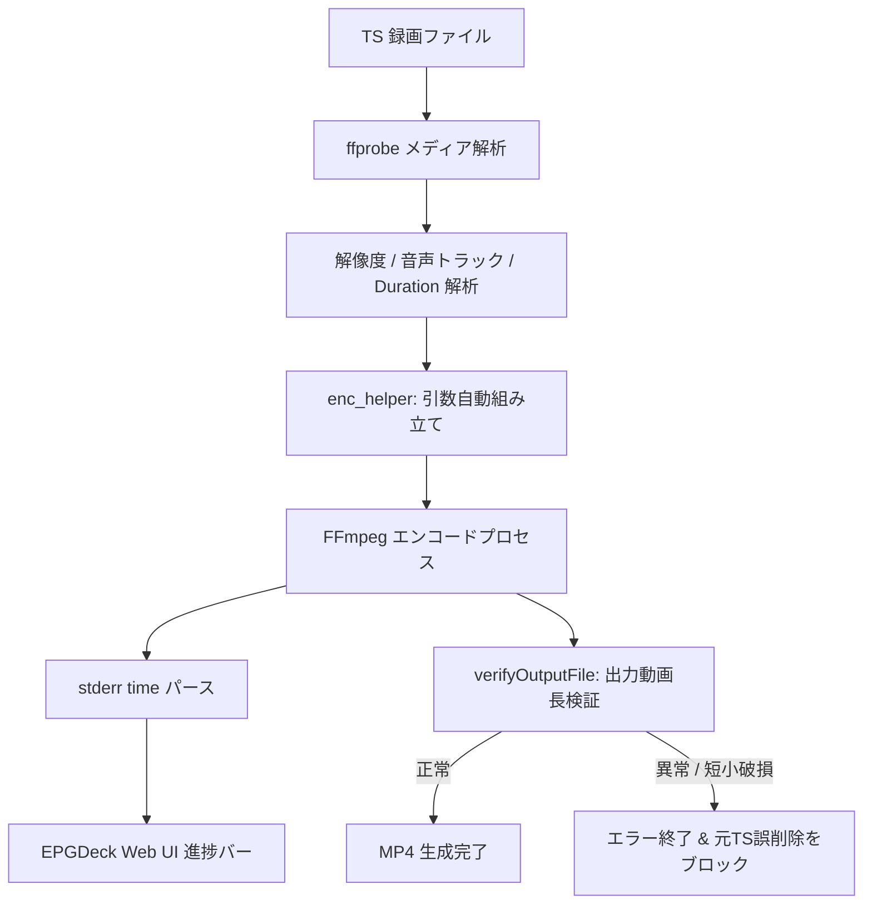

# EPGDeck エンコードシステム仕様書 & 設定マニュアル

EPGDeck のエンコード機能は、録画完了後の TS ファイルを MP4 等に自動変換し、Web UI やモバイル端末から快適に視聴できるようにするためのシステムです。

---

## 1. アーキテクチャと特徴

共通処理を公式共有パッケージ `@epgdeck/enc-helper`（`packages/enc-helper`）に集約し、堅牢で型安全なエンコード基盤を提供しています（※`config/enc_helper.js` からのインポートも互換性を維持しています）。



### 主な特徴・改善点
1. **地デジ 1440×1080 の柔軟なアスペクト比・解像度制御**:
   - **原寸維持時（デフォルト）**: 1440×1080 のまま無駄なリサイズを排して CPU 負荷とファイルサイズを約 15〜25% 節約。さらにビットストリームに `-vf setsar=4/3`、コンテナに `-aspect 16:9` を明記することで、QuickTime やブラウザ等あらゆるプレイヤーでの 4:3 縦長表示バグを確実に防止。
   - **縦解像度縮小時 (`maxHeight: 720` 等)**: 地デジ 1440×1080 等の非正方形 16:9 映像は、横解像度も正規 16:9（正方形ピクセル: `1280x720`, `960x540`, `854x480` 等）へ自動算出・正規化。
   - **1080p 正方形拡大 (`fix1440to1920: true`)**: スケーリングを行わず 1080p のまま 1920×1080 正方形ピクセルへ拡大したい場合に指定（VAAPI ハードウェアエンコード時は GPU スケーラーにより自動有効化）。
2. **多重音声・二重音声の柔軟なハンドリング**:
   - ニュース等の二重音声（デュアルモノ）を、**2トラック（Main / Sub）に分離** または **主音声のみ抽出** を選択可能。
   - スポーツ中継等のマルチ音声ストリームに対し、全トラック保持（`all`）または第1トラックのみ（`first`）を選択可能。主音声と副音声で個別のビットレート指定も可能。
3. **ドロップ破損・短小 MP4 の安全ブロック機能 (`verifyDuration`)**:
   - 出力された MP4 の動画長を `ffprobe` で自動検証。入力 TS に比べて極端に短い動画（ドロップ等による破損ファイル）を検知した場合、エラー終了させて **元 TS ファイルの誤削除を確実にブロック** します。
4. **Web UI 進捗バーとのリアルタイム連動**:
   - エンコード中の進捗率（0%〜100%）を自動計算し、Web UI の録画・エンコード一覧画面に進捗バーをリアルタイム表示します。
5. **FastStart 最適化**:
   - `-movflags faststart` により MP4 のメタデータ（moov atom）を先頭に配置し、ダウンロード完了を待たずに即座にシーク・ストリーミング再生が可能です。

---

## 2. 設定オプションリファレンス (`enc_helper.js`)

各設定ファイル（`config/enc.js` やプリセット）で `runEncode(options)` に渡せるパラメータ一覧です：

| オプション名 | 型 / 選択肢 | デフォルト値 | 説明 |
| :--- | :--- | :--- | :--- |
| **`codec`** | `string` | `'libx264'` | 映像コーデック。<br>・**CPU**: `libx264`, `libx265` (エイリアス: `h264`, `h265`, `x264`, `x265`, `hevc`)<br>・**NVENC**: `h264_nvenc`, `hevc_nvenc` (エイリアス: `h265_nvenc`, `nvenc`)<br>・**QSV**: `h264_qsv`, `hevc_qsv` (エイリアス: `h265_qsv`, `qsv`)<br>・**VAAPI**: `h264_vaapi`, `hevc_vaapi` (エイリアス: `h265_vaapi`, `vaapi`)<br>※`h265` と `hevc` のどちらの表記も自動解決されます |
| **`preset`** | `string` | `'medium'` | エンコード速度プリセット (`veryfast`, `fast`, `medium`, `p4` 等) |
| **`tune`** | `string \| null` | `null` | 映像チューニング (`'animation'`, `'film'`, `'grain'` 等。アニメの輪郭線・動き維持に有用) |
| **`crf`** | `number \| null` | `23` | 画質係数 (CPU / NVENC / QSV)。ビットレート指定時は `null` |
| **`videoBitrate`** | `string \| null` | `null` | 映像ビットレート（例: `'4500k'`, `'2500k'`） |
| **`maxrate`** | `string \| null` | `null` | 最大ビットレート制限（例: `'6000k'`） |
| **`bufsize`** | `string \| null` | `null` | VBV バッファサイズ（例: `'12000k'`） |
| **`scale`** | `string \| null` | `null` | 解像度プリセット (`'1080p'`, `'720p'`, `'540p'`, `'480p'`, `'native'`, `'W:H'`) |
| **`maxHeight`** | `number \| null` | `1080` | 最大縦解像度 (`1080`, `720`, `null` で維持)。縦解像度を縮小する場合、地デジ 1440x1080 等の 16:9 ソースは横解像度も正規 16:9 (720なら 1280x720) に自動調整されます |
| **`fix1440to1920`** | `boolean` | `false` (VAAPIは自動で `true`) | 地デジ 1440x1080 を 1920x1080 に拡大補正するかどうか (スケーリングなし時) |
| **`dualMono`** | `'split' \| 'main' \| 'sub'` | `'split'` | **二重音声の扱い**: <br>・`'split'`: 主音声・副音声を2トラックに分離<br>・`'main'`: 主音声のみ抽出<br>・`'sub'`: 副音声のみ抽出 |
| **`audioStreamMode`**| `'first' \| 'all'` | `'first'` | **複数音声ストリーム**: 第1トラックのみ (`first`) または全トラック保持 (`all`) |
| **`mainAudioBitrate`** | `string` | `1080p: '192k', 720p: '128k'` | 主音声（第1トラック）のビットレート (`-b:a:0`) |
| **`secondaryAudioBitrate`** | `string` | `'128k'` | 副音声（第2トラック以降）のビットレート (`-b:a:1...`) |
| **`subtitle`** | `boolean` | `false` | **字幕ストリームの扱い**: <br>・`false`: 字幕を除外 (`-sn`)<br>・`true`: MP4 字幕 (`mov_text`) として保持 |
| **`deinterlace`** | `boolean` | `true` | インターレース解除 (`yadif` または `deinterlace_vaapi`) |
| **`verifyDuration`** | `boolean` | `true` | 出力動画長の検証（ドロップ短小ファイルの安全ブロック） |
| **`minDurationRatio`**| `number` | `0.8` (80%) | 許容する最小時間比率（これを下回るとエラー終了し元 TS を保護） |
| **`faststart`** | `boolean` | `true` | Web 最適化 (`-movflags faststart`) |
| **`vaapiDevice`** | `string` | `'/dev/dri/renderD128'` | VAAPI 使用時の GPU デバイスパス |
| **`customArgs`** | `string[]` | `[]` | 任意の追加 FFmpeg 引数 |
| **`modifyArgs`** | `(args: string[]) => string[]` | `null` | 最終的な FFmpeg 引数配列を書き換えるコールバック関数 |

## 3. 設定ファイル (`config.yml`) でのプリセット指定

### 3.1 標準スクリプト指定 (`script`)
`config/` ディレクトリ配下に配置したスクリプト名（`script`）を指定する推奨の登録方法です。

```yaml
encode:
  presets:
    - name: H.264-1080p
      script: enc_1080p.js     # config/ 配下のファイル名を指定
      suffix: .mp4
    - name: H.264-720p
      script: enc_720p.js      # config/ 配下のファイル名を指定
      suffix: .mp4
```

### 3.2 独自コマンド・外部シェルスクリプト指定 (`cmd`)
Python スクリプトや外部シェルスクリプト、独自のエンコードバイナリを直接呼び出す場合は、`cmd` プロパティを使用します。
環境変数マクロ（`%NODE%`, `%ROOT%`, `%FFMPEG%`, `%FFPROBE%`）が展開されます。

```yaml
encode:
  presets:
    # 外部シェルスクリプトを呼び出す例
    - name: Custom-Shell
      cmd: '%ROOT%/config/custom_encode.sh'
      suffix: .mp4
    # Python 等の外部スクリプトを呼び出す例
    - name: Python-Transcoder
      cmd: 'python3 %ROOT%/config/transcode.py'
      suffix: .mkv
```

> [!NOTE]
> `cmd` 実行時、子プロセスには `INPUT`（元動画パス）、`OUTPUT`（出力先パス）、`RECORDEDID`（録画ID）、`FFMPEG`、`FFPROBE`、`NAME`（番組名）等の環境変数が自動的に渡されます。

### 3.3 プリセット設定パラメータ一覧

| パラメータ名 | 型 | 必須 | 説明 |
| :--- | :--- | :--- | :--- |
| **`name`** | `string` | **必須** | Web UI 上に表示されるプリセット表示名（例: `H.264-1080p`） |
| **`script`** | `string` | 任意 | `config/` ディレクトリ配下のエンコードスクリプト名（例: `enc_1080p.js`） |
| **`cmd`** | `string` | 任意 | 独自コマンド・外部シェルスクリプトを実行する場合のコマンド文字列 |
| **`suffix`** | `string` | 任意 | 出力ファイルの拡張子（例: `.mp4`, `.mkv`）。省略時は元ファイルの拡張子 |
| **`subtitle`** | `boolean` | 任意 | このプリセットで MP4 内に ARIB 字幕（`mov_text`）を埋め込むかどうか（省略時はグローバル `encode.subtitle` に従う） |

### 3.4 字幕に関するグローバル設定 (`config.yml`)

- **`encode.subtitle`**: 全プリセット共通の字幕保存デフォルト（デフォルト: `false`）。
- **`encode.skipSubtitleForSuperimpose`**: 番組情報に「字幕スーパー」が含まれる場合、映像自体に字幕が焼き込まれているため、ARIB 字幕埋め込み処理（`mov_text`）を自動的にスキップして二重描画やエンコードエラーを防止します（デフォルト: `false`）。

### 3.5 Web UI からの手動エンコード追加と元ファイル選択

録画番組の詳細画面（Web UI）から、任意のプリセットを指定して後から手動でエンコードキューへ追加できます。

- **エンコード元ファイルの選択**:
  - 対象番組に複数の動画ファイル（元 TS、既存のエンコード済み MP4 等）が存在する場合、どの動画ファイルを入力元（`INPUT`）とするかドロップダウンで選択できます。
  - **デフォルトは TS ファイル**（MPEG-2 TS）が自動選択されます。TS が削除済み等で存在しない場合は、先頭の動画ファイルが自動選択されます。
  - 動画ファイル一覧の各行にある「エンコード」ボタンからモーダルを開くことで、該当ファイルを元ファイルに事前選択した状態で即座に追加することも可能です。
- **元ファイルの自動削除オプション**:
  - 「エンコード完了後に元ファイルを自動削除」を有効化した場合、削除対象となるファイル名（例: `sample.ts`）がラベル横に明記され、意図しないファイルの誤削除を防止します。

---

## 4. プリセットテンプレート一覧

`config/` ディレクトリ内に用途別のテンプレートが用意されています。

### ① `enc.js` / `enc.js.template`（標準 CPU H.264）
```javascript
import { runEncode } from '@epgdeck/enc-helper';

runEncode({
    codec: 'libx264',
    preset: 'medium',
    // tune: 'animation', // アニメ向け ('animation' | 'film' | 'grain' 等)
    crf: 23,
    // maxrate: '4000k',  // 最大ビットレート制限 (bufsize は未指定時 maxrate*2 が自動設定)
    maxHeight: 1080,
    dualMono: 'split',
    subtitle: process.env.SUBTITLE === 'true' || false,
});
```

### ② `enc_1080p.js.template`（高品質 1080p）
```javascript
import { runEncode } from '@epgdeck/enc-helper';

runEncode({
    codec: 'libx264',
    preset: 'medium',
    // tune: 'film',      // 実写向け
    crf: 21,
    // maxrate: '5000k',  // 最大ビットレート制限
    maxHeight: 1080,
    dualMono: 'split',
    subtitle: process.env.SUBTITLE === 'true' || false,
});
```

### ③ `enc_720p.js.template`（軽量 720p / 主音声のみ）
```javascript
import { runEncode } from '@epgdeck/enc-helper';

runEncode({
    codec: 'libx264',
    preset: 'fast',
    // tune: 'animation',
    crf: 23,
    // maxrate: '2500k',  // 最大ビットレート制限
    maxHeight: 720,       // 地デジ 1440x1080 は自動で 1280x720 (16:9 正方形) に正規化
    dualMono: 'main',     // 主音声のみ抽出
    subtitle: process.env.SUBTITLE === 'true' || false,
});
```

### ④ `enc_vaapi.js.template`（Linux VAAPI ハードウェア）
```javascript
import { runEncode } from '@epgdeck/enc-helper';

runEncode({
    codec: 'h264_vaapi',
    vaapiDevice: '/dev/dri/renderD128',
    videoBitrate: '4500k',
    // maxrate: '6000k', // VBV 最大ビットレート制限
    maxHeight: 1080,    // 地デジ 1440x1080 を 1920x1080 に GPU 拡大補正
    dualMono: 'split',
    subtitle: process.env.SUBTITLE === 'true' || false,
});
```

### ⑤ `enc_qsv.js.template`（Intel QuickSync Video）
```javascript
import { runEncode } from '@epgdeck/enc-helper';

runEncode({
    codec: 'h264_qsv',
    preset: 'medium',
    crf: 23,
    // maxrate: '5000k',
    maxHeight: 1080,
    dualMono: 'split',
    subtitle: process.env.SUBTITLE === 'true' || false,
});
```

### ⑥ `enc_nvenc.js.template`（NVIDIA NVENC）
```javascript
import { runEncode } from '@epgdeck/enc-helper';

runEncode({
    codec: 'h264_nvenc',
    preset: 'p4',
    crf: 23,
    // maxrate: '5000k',
    maxHeight: 1080,
    dualMono: 'split',
    subtitle: process.env.SUBTITLE === 'true' || false,
});
```

### ⑦ `enc_1080p_x265.js.template`（CPU libx265 / HEVC）
```javascript
import { runEncode } from '@epgdeck/enc-helper';

runEncode({
    codec: 'libx265', // 'h265', 'x265', 'hevc' も指定可能
    preset: 'faster',
    crf: 26,          // H.264 CRF 23 同等。アニメなら 25〜27、実写なら 26〜28 が目安
    // tune: 'animation',
    maxHeight: 1080,
    dualMono: 'split',
    subtitle: process.env.SUBTITLE === 'true' || false,
});
```

### ⑧ `enc_nvenc_hevc.js.template`（NVIDIA NVENC H.265 / HEVC）
```javascript
import { runEncode } from '@epgdeck/enc-helper';

runEncode({
    codec: 'hevc_nvenc', // 'h265_nvenc' も指定可能
    preset: 'p4',
    crf: 26,             // NVENC は自動で -cq 26 に変換
    maxHeight: 1080,
    dualMono: 'split',
    subtitle: process.env.SUBTITLE === 'true' || false,
});
```

### ⑨ `enc_qsv_hevc.js.template`（Intel QSV H.265 / HEVC）
```javascript
import { runEncode } from '@epgdeck/enc-helper';

runEncode({
    codec: 'hevc_qsv',   // 'h265_qsv' も指定可能
    preset: 'medium',
    crf: 26,             // QSV は自動で -global_quality 26 に変換
    maxHeight: 1080,
    dualMono: 'split',
    subtitle: process.env.SUBTITLE === 'true' || false,
});
```

### ⑩ `enc_vaapi_hevc.js.template`（Linux VAAPI H.265 / HEVC コンテンツ適応型）
```javascript
import { runEncode } from '@epgdeck/enc-helper';

runEncode({
    codec: 'hevc_vaapi', // 'h265_vaapi' も指定可能
    vaapiDevice: '/dev/dri/renderD128',
    // コンテンツ適応型ビットレート自動推定 (事前プローブによる動的 VBR 算出)
    quality: 'high', // 'highest' | 'high' | 'standard' | 'economy' または CRF 数値
    // 固定ビットレートで運用したい場合は以下のように指定可能:
    // videoBitrate: '3000k',
    maxHeight: 1080,
    dualMono: 'split',
    subtitle: process.env.SUBTITLE === 'true' || false,
});
```

> [!TIP]
> **コンテンツ適応型プローブ (`quality`)**:
> `quality: 'high'`（または `'standard'`）を指定すると、エンコード開始前に GPU CQP サンプリングを行い、コンテンツの複雑度（インターレース解除済みノイズ、微細ディテール度 `qSlope`）を自動解析します。
> アニメ（約 1.1Mbps）やバラエティ（約 2.0Mbps）は極小容量化し、風景（約 2.8Mbps）や前面展望（約 8.5Mbps キャップ）は破綻しない適正ビットレートを自動配分します。

---

## 4. FFmpeg バージョン・ビルド要件と互換性

### 4.1 FFmpeg バージョン互換性

| 項目 | FFmpeg 4.x | FFmpeg 5.x 以降 | EPGDeck での対応 |
| :--- | :--- | :--- | :--- |
| **音声ビットレート** | `-ab 192k` / `-b:a 192k` | `-b:a 192k` | `-b:a` に統一（全バージョンで安全動作） |
| **チャンネル分離** | `channelsplit` | `channelsplit` (Channel Layout API) | `aformat=channel_layouts=mono` により完全互換 |
| **インターレース解除** | `yadif` / `deinterlace_vaapi` | 同左 | 標準フィルターとして全バージョン対応 |
| **進捗パース** | `time=HH:MM:SS.ms` | 同左 | 正規表現で全バージョン共通パース |

### 4.2 字幕機能 (`subtitle: true`) と `libaribb24` 要件

録画エンコード時に MP4 内へ ARIB 字幕（`mov_text`）を保持したい場合（`subtitle: true`）の動作要件です：

- **標準エンコード (`subtitle: false` [デフォルト])**:
  - **`libaribb24` 非対応の通常 FFmpeg で問題なく動作します**。
  - 字幕ストリームは自動的に除外（`-sn`）されるため、特別なデコーダーは一切不要です。
- **字幕保持有効 (`subtitle: true`)**:
  - ARIB STD-B24 字幕（`arib_caption`）を MP4 規格のテキスト字幕（`mov_text`）にデコード・変換するため、**`--enable-libaribb24` を有効化してビルドされた FFmpeg が必須** となります。
  - **非対応 FFmpeg で実行した場合の挙動**:
    - 入力 TS に字幕データが含まれる番組の場合、FFmpeg が `Decoder (codec arib_caption) not found for input stream` エラーを出力してエンコードが異常終了します。
    - ※ただし、`enc_helper.js` の出力検証機構（`verifyDuration`）により、異常終了時でも元 TS ファイルが削除されることはありません。
  - **対応方法**:
    - `libaribb24` 非対応の FFmpeg をお使いの場合は、プリセットの `subtitle` 設定を `false`（または省略）のまま運用してください。
    - 字幕を MP4 に埋め込みたい場合は、`libaribb24` 対応の FFmpeg をご用意ください。具体的なビルド手順は **[FFmpeg カスタムビルドガイド](ffmpeg-build.md)** を参照してください。

---

### 5. 実機検証・運用ノウハウ

### 5.1 実機エンコード比較 (Ryzen 5 5600G / Mesa Gallium 25.2.8)
地デジ 1440x1080 30fps 録画ファイル (242.8秒 / 481 MB) の実測値：

| 方式・設定 | 出力解像度 | 音声構成 | 出力サイズ | 変換速度 | 特徴 |
| :--- | :---: | :---: | :---: | :---: | :--- |
| **CPU 1440p (標準)** | 1440×1080 | 2トラック (Main/Sub) | **60 MB** | 6.7x (201 fps) | **【推奨】** 容量最少・最高画質。二重音声完全分離 |
| **CPU 1080p (拡大)** | 1920×1080 | 2トラック (Main/Sub) | **73 MB** | 5.3x (160 fps) | 1:1 正方形ピクセル |
| **CPU 720p (主音声)** | 1280×720 | 1トラック (Main) | **33 MB** | 8.5x (256 fps) | 軽量（1080pの半分以下）。モバイル向け |
| **VAAPI 1080p (GPU)** | 1920×1080 | 2トラック (Main/Sub) | **140 MB** | 5.0x (150 fps) | GPU ネイティブパイプライン |
| **VAAPI 720p (GPU)** | 1280×720 | 1トラック (Main) | **79 MB** | 6.4x (193 fps) | 低CPU負荷での 720p リサイズ |

### 5.2 CPU 発熱抑制ノウハウ
CPU エンコード（`libx264`）時の高熱対策として、OS 側（`cpupower` や `scaling_max_freq`）で最大クロックをターボブースト最大値から 10〜15% 程度制限することで、処理時間の微増（数%）にとどめつつピーク温度を大幅に抑制可能です。

### 5.3 VAAPI パイプライン最適化
- **全工程 GPU VRAM 処理**: `-hwaccel vaapi -hwaccel_output_format vaapi` によりデコードからスケーリング・エンコードまで VRAM 内で完結させ、ホストメモリ往復による緑線・表示ズレを防止。
- **HEVC メタデータ補正**: HEVC エンコード時に `-bsf:v hevc_metadata=height=${res.targetH}` を付与し、Mesa ドライバの 1088px パディングによる下部黒帯を補正。

### 5.4 VAAPI 適応型ビットレート制御 (`quality`) と使い分け指針
`enc_vaapi_hevc.js.template` では、エンコード前の約2秒間にメモリ内（`-f null -`）で番組全体を高速サンプリングし、映像の複雑度に応じた最適な VBR ビットレートを自動算出します。

| 用途 | 推奨方式 | 推奨設定 | 理由 |
| :--- | :--- | :--- | :--- |
| **日常録画全般** (ドラマ・バラエティ) | **VAAPI HEVC** | `quality: 'high'` | CPU負荷ほぼゼロ・高速消化。x264 より 40〜50% 省容量 |
| **アニメ作品の永久保存** | **CPU x265** | `preset: 'faster'`, `crf: 26` | ベタ塗り領域の極限圧縮（VAAPI 比 35% 以上省容量） |
| **前面展望・激しいライブ** | **CPU x265** | `preset: 'faster'`, `crf: 26` | 高周波・激しい動きでのブロックノイズ破綻を完全防止 |
| **モバイル向け省容量** | **VAAPI HEVC** | `scale: '720p'`, `quality: 'standard'` | 30分 100〜130MB へ高速リサイズ |


